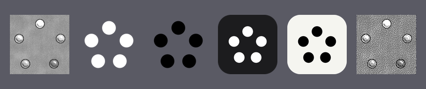

# Icon variants

The app ships with the stone icon. If your launcher lets you change icons (Nova, Lawnchair, Niagara and others), here are a few more to pick from. They're all 512×512 PNGs.

| File | Looks like |
| --- | --- |
| `original.png` | The app's own stone icon |
| `silhouette-white.png` | Five white dots, transparent. Fits white glyph icon packs |
| `silhouette-black.png` | Five black dots, transparent |
| `silhouette-white-on-dark.png` | White dots on a dark tile |
| `silhouette-black-on-light.png` | Black dots on a light tile |
| `dithered.png` | The stone icon dithered to 1-bit, like it would come out of the printer |

To use one in Nova: copy it to your phone, long-press the app icon → Edit → tap the icon → Gallery apps → pick the file.
