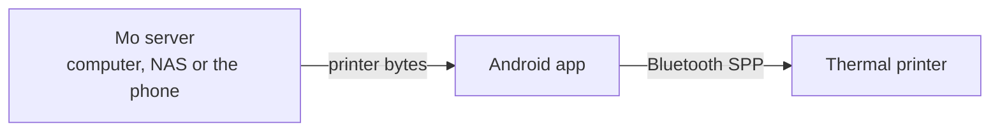

# How phone printing works

The technical side: the printer, what I changed in Mo, and running it yourself. To just get printing, see the [Quick Start Guide](QUICKSTART.md).

Mo makes the print data and the app sends it to the printer over Bluetooth. Mo can run on a computer, a NAS, or inside the app.



The app doesn't know the printer's commands, so a different printer only needs a new driver on the server side.

## The S1 printer

The S1 doesn't use ESC/POS and isn't a "cat printer". I got its commands from its app, HerePrint, which uses HPRT's SDK (`com.poooli.printersdk`).

Images go in chunks of 30 rows, each a 12-byte header plus LZO1X data:

| Bytes | Meaning |
| --- | --- |
| `1D 76 30 30` | Start of chunk |
| 2 bytes, little-endian | Bytes per row (48) |
| 2 bytes, little-endian | Rows in this chunk (30, fewer for the last) |
| 4 bytes, little-endian | Data length |
| data | LZO1X 1-bit image, MSB first, 1 = black |

The driver doesn't really compress. It sends one uncompressed LZO1X run, which the printer accepts.

| Command | Bytes |
| --- | --- |
| Darkness (0–255) | `1D 73 65 74 63 <n>` |
| Speed | `1D 73 65 74 73 <n>` |
| Feed n dots | `1B 1B 01 <lo> <hi>` |
| Test page | `1B 1B 00` |

Use Bluetooth Classic SPP (UUID `00001101-0000-1000-8000-00805F9B34FB`), not BLE. HerePrint only uses BLE to find the printer. I tried BLE first and it dropped every full-size token partway through.

### Other printers

Try ESC/POS or the cat printer commands first. If neither works, open the printer's app in [jadx](https://github.com/skylot/jadx) and look for its SDK, or capture what it sends with Android's Bluetooth HCI snoop log and Wireshark. Then write your own `app/printer.py` with the same functions as mine.

## What I changed in Mo

| File | What it does |
| --- | --- |
| `app/printer.py` | The S1 driver, replacing Mo's ESC/POS one |
| `app/routes/printdata.py` | Printer bytes at `/api/print-data/...` for the app |
| `js/modules/bridge.js` | Sends print jobs to the app |
| `js/modules/*.js` | Print buttons try the app first, then the server's printer |
| `app/routes/decklist.py` | Download missing cards from Deck Print |
| `app/routes/setup.py`, `app/templates/` | The setup and phone pages |
| `scripts/build_data.py` | Downloads all the card data in one go |
| `Dockerfile`, `docker/`, `setup/` | The server image and setup scripts |
| `android/` | The app. See [android/README.md](../android/README.md) |

In a normal browser the print buttons work like they always did.

## Running it yourself

```
git clone https://github.com/mo-mobile/mo-mobile.git
cd mo-mobile
pip install -r requirements.txt
python scripts/build_data.py
```

That downloads the card list from MTGJSON and the images from Scryfall, dithered for the printer. Everything is about 1 GB and half an hour. Use `--types token,creature` (or `instant`, `sorcery`, `artifact`, `enchantment`, `land`, `planeswalker`, `battle`, `top8`) to only get some. If you change anything in `js/`, run `npm install` and `npm run build`.

To print from a computer, pair the printer, find its serial port (the Outgoing COM port on Windows, `/dev/rfcomm0` on Linux), and run:

```
set MO_PRINTER_DEVICE=COM12
python -m app.app
```

`MO_PRINTER_DENSITY` sets darkness (default 75) and `MO_PRINTER_FEED` sets blank paper after a print (default 100 dots).

## Running the server

The setup script in the Quick Start uses my image, `ghcr.io/mo-mobile/mo-mobile`. To build your own, run `docker compose up -d --build` in the repo. Card data goes in a volume at `/app/store`. On a NAS you can mount a folder there instead, like `-v /volume1/docker/mo-mobile:/app/store`.

| Variable | What it does |
| --- | --- |
| `MO_PUBLIC_URL` | The address for the QR code, if you open the setup page as `localhost` |
| `MO_AUTO_BUILD` | Download cards on startup without the setup page, `all` or like `token,creature` |

The code is built into the image, so rebuild after changing it. On Synology, delete the old image first or Container Manager reuses it.

## The app

The app shows Mo in a WebView. When you hit Print, the page gets the bytes and calls `MoPrinter.printBytes()`, and the app writes them to the printer 1 KB at a time. It waits a few seconds before disconnecting, otherwise the end of the image gets cut off. In the phone-only mode Mo runs inside the app on `127.0.0.1:8421`.

It picks the printer by itself if one paired device has `S1-`, `IDPRT` or `HPRT` in its name. Otherwise it asks. Add other names to `NAME_HINTS` in `MainActivity.kt`.

Only one phone can be connected to the printer at a time, and the app stays connected between prints. To share a printer, change `writeJob` to disconnect after each print.

## Troubleshooting

| Problem | Fix |
| --- | --- |
| The image gets cut off | The connection closed too early. Make the wait longer, and use SPP, not BLE |
| Nothing prints | Make sure a computer isn't holding the printer's COM port |
| Too much blank paper | Lower `MO_PRINTER_FEED` |
| Print data 404 | That image isn't downloaded. Check `images_dithered/` |
| A code change does nothing | Rebuild the image, don't just restart |

For the app's logs, filter Logcat with `tag:MoMobile | tag:chromium`.
