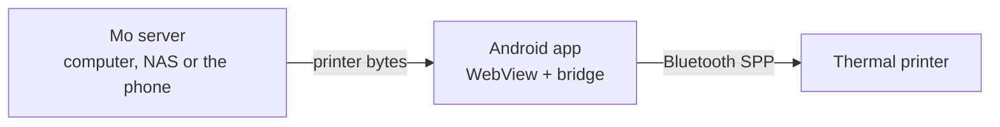
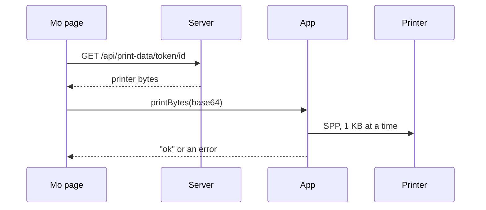

# How phone printing works

This is the technical side of Mo Mobile: how the printer talks, what I changed in Mo, and how to build it yourself. If you just want to get printing, the [Quick Start Guide](QUICKSTART.md) is all you need.

## The basic idea

Mo makes the print data and the phone app sends it to the printer over Bluetooth. That's the whole split. The Mo server can be on a computer, a NAS, or inside the app itself.



The server never deals with Bluetooth, and the app doesn't know anything about the printer's commands. So if you want to use a different printer, you only change the driver on the server side.

I built and tested all of this with an iDPRT/HPRT S1 (48 mm paper, 384 dots wide).

## The S1 printer

The S1 doesn't use ESC/POS, and it isn't one of the "cat printers" either. I figured out its commands by digging through its official app, HerePrint, which uses HPRT's Android SDK (`com.poooli.printersdk`).

### How it takes an image

Images go in chunks of 30 rows. Each chunk is a 12-byte header followed by LZO1X data:

| Bytes | Meaning |
| --- | --- |
| `1D 76 30 30` | Start of an image chunk |
| 2 bytes, little-endian | Bytes per row (48 for 384 dots) |
| 2 bytes, little-endian | Rows in this chunk (30, or fewer for the last one) |
| 4 bytes, little-endian | Length of the data |
| data | LZO1X-compressed 1-bit image, MSB first, 1 = black |

The driver doesn't actually compress anything. It sends a valid LZO1X stream that's just one uncompressed run, and the printer is fine with that. Other commands:

| Command | Bytes |
| --- | --- |
| Darkness (0–255, HerePrint uses 55/75/95) | `1D 73 65 74 63 <n>` |
| Speed | `1D 73 65 74 73 <n>` |
| Feed n dots | `1B 1B 01 <lo> <hi>` |
| Test page | `1B 1B 00` |

### Bluetooth Classic, not BLE

This one cost me the most time. HerePrint only uses BLE to find the printer. The actual printing goes over Bluetooth Classic SPP (RFCOMM, UUID `00001101-0000-1000-8000-00805F9B34FB`).

I tried BLE first. Test pages and short prints worked, but it dropped the connection partway through every full-size token no matter how slowly I sent the data. SPP has proper flow control and handles big images fine.

### Using a different printer

Figure out what commands your printer uses before you write any code. Easiest to hardest:

1. Try the common ones. A lot of cheap printers use ESC/POS or the "cat printer" commands (`51 78` at the start). Search your model name with those words.
2. Look inside the printer's app. Get its APK, open it in [jadx](https://github.com/skylot/jadx), and search for the SDK and anything about raster, bitmap or print. That's how I found the S1's commands.
3. Watch what the app sends. In Android's Developer options, turn on Bluetooth HCI snoop log, print something from the printer's app, then grab the log from a bug report and open it in Wireshark.

Also check if the printer's app uses BLE or SPP. If the printer shows up as a serial (COM) port when you pair it to a computer, it has SPP, and you should use that.

Once you know the commands, write your own `app/printer.py` with the same functions as mine (`_cmd_density`, `_cmd_feed`, `_cmd_image_bands`, `_image_to_raster_data`). Nothing else has to change.

## What I changed in Mo

| File | What it does |
| --- | --- |
| `app/printer.py` | The S1 driver over SPP. It replaces Mo's ESC/POS one and keeps the same functions |
| `app/routes/printdata.py` | New. Hands out printer bytes at `/api/print-data/token/<id>`, `/card/...`, `/avatar` and `/decklist` |
| `app/app.py` | Turns on the routes above |
| `js/modules/bridge.js` | New. Finds the Android app, sends it the bytes, and shows "Printer not responding" when Bluetooth fails |
| `js/main.js` | Loads `bridge.js` |
| `js/modules/momir.js` | Momir prints through the phone (the original prints on the server as soon as a card is picked) |
| `js/modules/tokens.js`, `card-search.js`, `decklist.js`, `stonehewer.js`, `ui-helpers.js` | Every print button tries the phone first, then the server's printer |
| `js/modules/decklist.js`, `app/routes/decklist.py` | Download missing cards from Deck Print, one at a time or all at once |
| `android/` | The Android app. See [android/README.md](../android/README.md) |
| `app/routes/setup.py`, `app/templates/setup.html`, `phone.html` | The setup page (pick cards, progress, QR code) and the phone page |
| `scripts/build_data.py` | Downloads and builds all the card data in one go |
| `Dockerfile`, `docker-compose.yml`, `docker/entrypoint.sh` | The server image |
| `setup/` | The setup scripts for Windows, Mac and Linux |

Every print button works the same way:

```js
const handled = await this.printViaBridge(`/api/print-data/token/${id}`);
if (!handled) {
    await fetch(`/api/print/token/${id}`, { method: 'POST' });
}
```

In a normal browser `printViaBridge` returns `false`, so printing from a computer still works like it always did.

## Running it yourself

```
git clone https://github.com/mo-mobile/mo-mobile.git
cd mo-mobile
pip install -r requirements.txt
```

### Card data

None of the card images are in the repo. This script gets everything: the card list from MTGJSON, card and token images from Scryfall, the Momir/Jhoira/Stonehewer avatars, and the search index.

```
python scripts/build_data.py
```

Images get dithered for the printer as they download, so only the small printer-ready copies are saved. Everything is about 35,000 files and 1 GB, and takes around half an hour. If you only want some, add `--types` with any of `token`, `creature`, `instant`, `sorcery`, `artifact`, `enchantment`, `land`, `planeswalker`, `battle` and `top8` (Top 8 deck lists from mtgtop8.com), like `--types token,creature`. Run it again with other types to add them. It skips anything it already has.

Dithering is Floyd–Steinberg at 384 px wide, with dark images brightened a bit first.

The JavaScript (`app/static/js/mo.min.js`) is already built. If you change anything in `js/`, run `npm install` and `npm run build`.

### Printing from a computer

Pair the printer with your computer and find its serial port. On Windows, pairing makes two "Standard Serial over Bluetooth link" ports. You want the Outgoing one, which you can find under More Bluetooth settings → COM Ports. On Linux, use `rfcomm` to get `/dev/rfcomm0`. Then:

```
set MO_PRINTER_DEVICE=COM12
python -m app.app
```

Open the page and print a token. A full-size token is a good test because it shows long images make it through. `MO_PRINTER_DENSITY` sets the darkness (default 75) and `MO_PRINTER_FEED` sets how much blank paper comes out after each print (default 100 dots).

## Running the server

The server runs Mo in Docker and never needs Bluetooth, so it can go on anything that runs Docker: a NAS, a VPS, or a regular computer.

The easy way is the setup script in the [Quick Start Guide](QUICKSTART.md). It uses my image, `ghcr.io/mo-mobile/mo-mobile`. To build it from the code instead, run `docker compose up -d --build` in the repo.

All the card data goes in one volume at `/app/store`. The setup page (`/setup`) is where you pick cards, and it shows the progress and a QR code for the phone. You can pause the download and pick it back up, and if the server restarts mid-download it carries on by itself.

If you'd rather see the files on a NAS, use a folder instead of a volume, like `-v /volume1/docker/mo-mobile:/app/store`. On Synology, go to Container Manager → Project → Create, point it at the repo folder, and use its compose file.

Settings:

| Variable | Default | What it does |
| --- | --- | --- |
| `MO_PUBLIC_URL` | (none) | The address your phone uses, for the QR code. You only need it if you open the setup page as `localhost` |
| `MO_AUTO_BUILD` | (none) | Download cards on startup without the setup page, either `all` or a list like `token,creature`. Useful on a NAS |

To check the server is working once the cards are downloaded:

```
curl -sI http://<server>:8420/api/print-data/token/<token-id>
```

You should get `200 OK` with `Content-Type: application/octet-stream` and an `X-Printer-Bytes` header. A token is usually about 26 KB.

The code is built into the image, so if you change it you have to rebuild, not just restart. On Synology, Container Manager's Build reuses the old image, so stop the project, run Clean, delete the image, and then Build.

### Away from home

Your phone can only reach the server on your home network. I use [Tailscale](https://tailscale.com) to get around that. You could also put the server behind a reverse proxy with a certificate, like `mo.yourdomain.com` → `http://localhost:8420`. On Synology that's in Control Panel → Login Portal → Advanced → Reverse Proxy.

## The Android app

The app is a WebView showing Mo, plus a JavaScript bridge called `MoPrinter`. When you hit Print, the page gets the bytes from `/api/print-data/...` and hands them to `MoPrinter.printBytes()`, and the app sends them to the printer.



In the phone-only mode, the app runs Mo's Python server itself on `127.0.0.1:8421` and the same thing happens, just without leaving the phone.

Everything the app does, what it can access, and how to build it is in [android/README.md](../android/README.md).

### Things I learned the hard way

- Use SPP, not BLE. The app opens an RFCOMM socket to UUID `00001101-...`.
- Send 1,024 bytes at a time and flush after each. One giant write doesn't work.
- Don't close the connection too soon. The app waits 3 seconds plus 250 ms per KB after the last write. If it closes earlier, the printer loses whatever it hasn't printed yet and the image gets cut off.
- Android 12 and newer want the scan permission for `cancelDiscovery()`. The app doesn't have it, so it tries that call and moves on if it fails.
- Only open pages from your server in the app. The bridge gives Bluetooth access to whatever page is loaded, so links to other sites open in your browser.

The app picks the printer by itself if exactly one paired device has `S1-`, `IDPRT` or `HPRT` in its name. Otherwise it asks. If your printer's name is different, add it to `NAME_HINTS` in `MainActivity.kt`.

### Sharing at the table

Friends with Android phones can print too. They install the app, pair the printer, and either run it on their own phone or connect to your server.

Only one phone can be connected to the printer at a time, and the app stays connected between prints. If you want to pass one printer around, change `writeJob` to disconnect after each print. Otherwise the first phone keeps it until its app closes.

Anyone who can reach your server can use it, so if that matters, put a login on it at the reverse proxy.

## Troubleshooting

In Android Studio, filter Logcat with `package:mine (tag:MoMobile | tag:chromium)`. `MoMobile` shows the app's Bluetooth log and `chromium` shows errors from the page.

| Problem | Fix |
| --- | --- |
| "Pick your printer" | None of your paired devices matched `NAME_HINTS`, or more than one did. Pick it once and it remembers |
| The image gets cut off | The connection closed before the printer finished. Make the wait longer. If you're on BLE, switch to SPP |
| Nothing prints and there's no error | Check Logcat to see if `connect()` worked. Make sure a computer isn't holding the printer's COM port open |
| Too much blank paper | Lower `MO_PRINTER_FEED` and rebuild the container |
| Print data 404 | The image isn't on the server. Check `images_dithered/<type>/<cmc>/` (or `images_dithered/token/` for tokens) |
| A code change doesn't do anything | The code is built into the image. Rebuild, don't just restart |
| The app icon is inside a frame | Some icon packs put a frame around apps they don't know. Switch your launcher to system icons |
