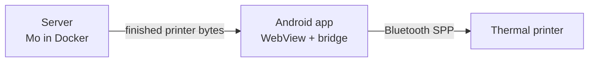
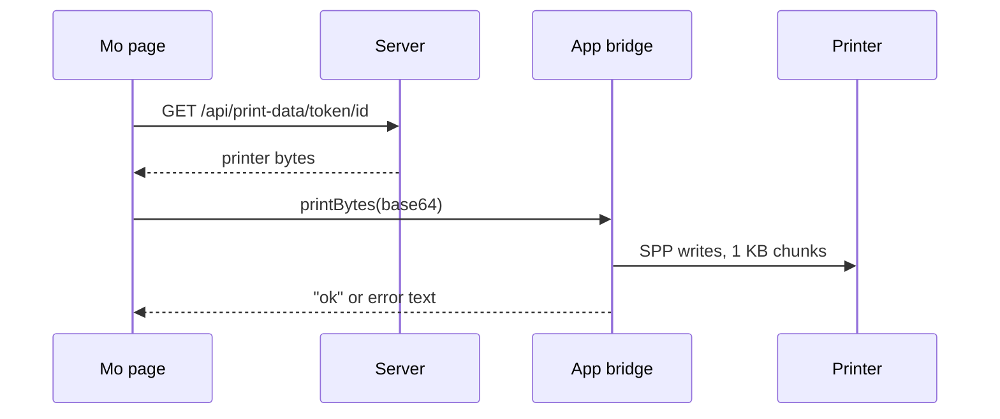

# Phone printing with Mo Mobile

## Overview

You end up with a phone app that prints Magic tokens and random creatures on a pocket Bluetooth thermal printer, served from your own web server. It builds on [Mo](https://github.com/ojazeker/Mo), an open-source Momir Basic web app, and was proven on an iDPRT/HPRT S1 (48mm, 384-dot head).

The server does all image and protocol work. The phone app is a thin wrapper: a WebView showing the Mo site, plus a bridge that writes finished printer bytes to Bluetooth.



The server never touches Bluetooth, and the app knows nothing about the printer protocol. Supporting a different printer means changing only the server-side driver.

### What you need

| Item | Notes |
| --- | --- |
| Bluetooth thermal printer | iDPRT/HPRT S1 or a relative; others need protocol work (next section) |
| Windows or Linux PC with Bluetooth | For testing the printer and building data |
| Always-on server | A NAS with Docker, a VPS, or a home PC; needs about 1 GB for every card type plus tokens |
| Android phone | Android 8 or newer; iPhones cannot run this app |
| Software | Python 3.10+, Node.js, Android Studio, Docker |
| A domain name (optional) | For HTTPS access away from home |

## Know your printer

The S1 does not speak ESC/POS, and it is not a "cat printer" either. Its protocol was recovered from the vendor app, HerePrint, whose code includes HPRTAndroidSDK (`com.poooli.printersdk`).

### The S1 protocol

An image is sent as bands of 30 rows. Each band is a 12-byte header followed by an LZO1X payload:

| Bytes | Meaning |
| --- | --- |
| `1D 76 30 30` | Magic |
| 2 bytes, little-endian | Bytes per row: 48 for a 384-dot head |
| 2 bytes, little-endian | Rows in this band (30, fewer in the last band) |
| 4 bytes, little-endian | Length of the compressed payload |
| payload | LZO1X-compressed 1-bit raster, MSB first, bit set = black |

The drivers skip real compression: they emit a valid LZO1X stream made of one literal run, which the printer accepts. Other commands:

| Command | Bytes |
| --- | --- |
| Density (0–255; vendor app uses 55/75/95) | `1D 73 65 74 63 <n>` |
| Speed | `1D 73 65 74 73 <n>` |
| Feed n dots | `1B 1B 01 <lo> <hi>` |
| Self-test page | `1B 1B 00` |

### Use Bluetooth Classic SPP, not BLE

This is the most expensive lesson in the project. HerePrint uses BLE only to find the printer. Print data goes over Bluetooth Classic SPP (RFCOMM, UUID `00001101-0000-1000-8000-00805F9B34FB`).

BLE accepted test pages and short strips, then dropped the link partway through every full-height token, however the writes were paced. SPP has real flow control and no practical size limit.

### If you have a different printer

Find out what it speaks before writing any code. In order of effort:

1. Try known protocols. Many cheap printers are ESC/POS or "cat printer" (`51 78` framing); search for your model with those words.
2. Decompile the vendor app. Pull its APK and open it in [jadx](https://github.com/skylot/jadx). Search for the SDK package and for raster, bitmap or `print` methods. This is how the S1 protocol was found.
3. Capture traffic. On Android, enable Developer options → Bluetooth HCI snoop log, print from the vendor app, then pull the log with a bug report. Open it in Wireshark.

Check whether the vendor app sends over BLE or SPP. If the printer shows up as a serial port when paired to a PC, it has SPP; use that.

## Step 1: Test the printer from a PC (optional)

Prove the printer works over SPP before involving a phone. The quickest way is Mo itself: pair the printer with your PC, find its serial port, and print a token with `MO_PRINTER_DEVICE` set (see "Test locally" in Step 2).

1. Pair the printer in Windows Bluetooth settings.
2. Find its COM port. Windows creates two "Standard Serial over Bluetooth link" ports; you need the Outgoing one, listed under More Bluetooth settings → COM Ports. On Linux, bind it with `rfcomm` to get `/dev/rfcomm0`.

A full-height token proves both the protocol and that long images arrive intact. If the tail of a long image goes missing, the port is closing before the printer drains; see Troubleshooting.

## Step 2: Get the code

This fork already contains the S1 driver, the print-data endpoints and the phone bridge, so there is nothing to patch by hand.

```
git clone https://github.com/mo-mobile/mo-mobile.git
cd mo-mobile
pip install -r requirements.txt
npm install
```

### What the fork changes

| File | What it does |
| --- | --- |
| `app/printer.py` | S1 protocol over SPP (replaces Mo's ESC/POS module; same public functions) |
| `app/routes/printdata.py` | New. Serves byte streams at `/api/print-data/token/<id>`, `/card/...`, `/avatar` and `/decklist` |
| `app/app.py` | Registers the `printdata` blueprint |
| `js/modules/bridge.js` | New. Detects the Android app, sends it bytes, and turns Bluetooth errors into "Printer not responding" |
| `js/main.js` | Imports `bridge.js` |
| `js/modules/momir.js` | Momir prints through the phone (upstream prints server-side when a card is drawn) |
| `js/modules/tokens.js`, `card-search.js`, `decklist.js`, `stonehewer.js`, `ui-helpers.js` | Each print button tries the bridge first, then falls back to the server printer |
| `android/` | The Android app |
| `app/routes/setup.py`, `app/templates/setup.html`, `phone.html` | First-run setup page (build progress, QR code) and the phone page |
| `scripts/build_data.py` | Builds all card data in one go; used by the container on first start |
| `Dockerfile`, `docker-compose.yml`, `docker/entrypoint.sh` | Server image |
| `setup/` | One-click setup scripts for Windows, Mac and Linux |

Every print call site follows the same pattern:

```js
const handled = await this.printViaBridge(`/api/print-data/token/${id}`);
if (!handled) {
    await fetch(`/api/print/token/${id}`, { method: 'POST' });
}
```

`printViaBridge` returns `false` in a normal browser, so desktop printing keeps working unchanged.

### Build the data and the frontend

The repo ships no card images. One script builds everything: MTGJSON card data, every card and token image from Scryfall, the Momir/Jhoira/Stonehewer avatars, and the search index.

```
python scripts/build_data.py
```

Images are dithered as they download, so only the printer-ready copies are saved: about 35,000 files and 1 GB for everything. Add `--types token,creature` (any of token, creature, instant, sorcery, artifact, enchantment, land, planeswalker, battle) to download only some; run it again with others to add them. It takes around half an hour on a decent connection, and a re-run skips anything already done. (The individual steps are in `scripts/build/` if you want to run them by hand; `download_images.py` and `download_tokens.py` keep full-size originals unless you pass `--dither`.)

The JavaScript bundle (`app/static/js/mo.min.js`) is committed. Rebuild it with `npm install` and `npm run build` only if you change files in `js/`.

Dithering uses Floyd–Steinberg at 384 px wide, after a brightness lift for dark images.

### Test locally

Set the printer port and run Mo:

```
set MO_PRINTER_DEVICE=COM12
python -m app.app
```

Open the page and print a token. Optional settings: `MO_PRINTER_DENSITY` (default 75) and `MO_PRINTER_FEED` (dots of blank paper after each print, default 100).

For another printer, write your own `app/printer.py` with the same functions (`_cmd_density`, `_cmd_feed`, `_cmd_image_bands`, `_image_to_raster_data`). Nothing else in this guide changes.

## Step 3: Host Mo on a server

The server runs Mo in Docker under gunicorn and never needs Bluetooth. Any Docker host works: a NAS, a VPS, or a home PC.

### Running it

The easy way is the setup script in the [Quick Start Guide](QUICKSTART.md), which runs the published image `ghcr.io/mo-mobile/mo-mobile`. From source, `docker compose up -d --build` in the repo does the same thing.

Either way, all card data lives in one volume mounted at `/app/store`. The setup page at `/setup` asks which kinds of cards to download, runs `scripts/build_data.py` in the background, and shows the progress and a QR code for the phone. Everything is about half an hour and 1 GB; you can add more kinds later on the same page. A restart resumes an unfinished download.

On a NAS where you'd rather see the files, mount a folder instead of a volume, for example `-v /volume1/docker/mo-mobile:/app/store`. On Synology: Container Manager → Project → Create, point it at the repo folder, and use its compose file.

Settings (environment variables):

| Variable | Default | What it does |
| --- | --- | --- |
| `MO_PUBLIC_URL` | (none) | The address phones use, for the QR code. Only needed if you open the setup page as `localhost` |
| `MO_AUTO_BUILD` | (none) | Download cards on startup without using the setup page: `all`, or a list like `token,creature`. Handy on a NAS with no browser nearby |

Confirm the server produces print data once the build is done:

```
curl -sI http://<server>:8420/api/print-data/token/<token-id>
```

You should get `200 OK`, `Content-Type: application/octet-stream` and an `X-Printer-Bytes` header. A typical token is about 26 KB.

Because `app/` is baked into the image, any code change needs a rebuild, not just a restart. On Synology, Container Manager's Build reuses an existing image, so stop the project, run Clean, delete the image, then Build.

### HTTPS for the phone

For use away from home, put a reverse proxy in front with a certificate (or use a VPN such as Tailscale), for example `mo.yourdomain.com` → `http://localhost:8420`. On Synology this is Control Panel → Login Portal → Advanced → Reverse Proxy. HTTPS lets the app work away from home without allowing cleartext traffic.

## Step 4: Build the Android app

The app is one Kotlin file, `MainActivity.kt`: a WebView locked to your server, plus a JavaScript bridge named `MoPrinter`. The page fetches bytes from `/api/print-data/...`, base64-encodes them, and calls `MoPrinter.printBytes()`.



### Build it

The project is in `android/`. Open that folder in Android Studio (File → Open), let Gradle sync, plug in the phone with USB debugging on, and press Run. Or build from a terminal with JDK 17 and the Android SDK installed:

```
cd android
./gradlew assembleDebug
```

The APK lands in `android/app/build/outputs/apk/debug/`.

### Server address

The app has no server baked in. On first launch it asks for the address of your Mo server, for example `192.168.1.20:8420` or `https://mo.yourdomain.com`. To change it later, long-press the app icon → Change server. A server's `/phone` page also has a Connect button: it opens `momobile://connect?server=...`, and the app asks before switching. If the server can't be reached, the app offers Retry or Change server.

To bake an address into a build (so it opens straight to your server), pass it to Gradle:

```
./gradlew assembleDebug -PmoServerUrl=http://192.168.1.20:8420
```

### Rules the app follows

Each of these fixed a real failure:

- SPP, not BLE. It opens an RFCOMM socket to UUID `00001101-...`.
- Chunked writes. It writes 1,024 bytes at a time with a flush after each, never one giant write.
- Hold the socket open. It waits 3 s plus 250 ms per KB after the last write. Closing sooner discards bytes the printer has not consumed, cutting off the image.
- No scan permission. Android 12+ requires `BLUETOOTH_SCAN` for `cancelDiscovery()`, so the app treats that call as best-effort and connects anyway.
- Same-origin only. The bridge exposes Bluetooth to whatever page is loaded, so links to other sites open in the system browser.

The app auto-selects the printer when exactly one paired device's name contains `S1-`, `IDPRT` or `HPRT`. Otherwise it shows a picker. Add your printer's name to `NAME_HINTS` if it differs.

### Name and icon

- Name: edit `app_name` in `res/values/strings.xml`.
- Icon: right-click `app` → New → Image Asset → Launcher Icons (Adaptive and Legacy). Use a 1024×1024 source image. Set the foreground image with Resize at about 75–80%, a solid background color, and a transparent single-color image on the Monochrome tab for Android 13+ themed icons.

Every launcher masks icons to its own shape, so design the icon to fill that shape.

### Install

Run from Android Studio, or install the APK with `adb install` or by opening it on the phone (allow installs from unknown sources when asked). The app stays installed afterward; open it from the app drawer.

To give the app to others, use Build → Generate Signed App Bundle or APK → APK, and keep the keystore safe. Updates must be signed with the same key.

## Step 5: Print, share and troubleshoot

Pair the printer once in the phone's Bluetooth settings, open the app, and press Print on any token. The first print takes about half a second to connect.

### Sharing at the table

Friends with Android phones can use your printer too:

1. Host the APK on your server and print a QR code linking to it.
2. They install it, allowing installs from unknown sources when asked.
3. They pair the printer in Bluetooth settings.

SPP allows one connection at a time, and the app keeps its socket open between prints. To share one printer, change `writeJob` to close the socket after the drain wait; otherwise the first phone holds it until its app closes.

Anyone with the APK or your server's URL can use your server. Add authentication at the reverse proxy if that matters to you.

### Troubleshooting

In Android Studio, filter Logcat with `package:mine (tag:MoMobile | tag:chromium)`. The first shows the app's Bluetooth log; the second shows the page's console errors.

| Symptom | Cause and fix |
| --- | --- |
| `SecurityException: Need BLUETOOTH_SCAN` | An old build calls `cancelDiscovery()` without catching it. Rebuild with the try/catch, then Build → Clean Project and Run |
| "Pick your printer" | No paired device matched `NAME_HINTS`, or several did. Pick it from the list once |
| Image cuts off partway | The socket closed before the printer drained. Increase the drain wait. On BLE, switch to SPP |
| Nothing prints, no error | Check Logcat for `connect()` success. Make sure no PC holds the printer's COM port open |
| Too much blank paper | Lower `MO_PRINTER_FEED`, then rebuild the container |
| Print data 404 | The image is missing on the server. Check `images_dithered/<type>/<cmc>/` (or `images_dithered/token/` for tokens) |
| Code change has no effect on the server | `app/` is baked into the image. Rebuild, don't just restart |
| App icon sits inside a frame | A launcher icon pack frames apps it doesn't know. Switch the launcher to system icons to see the real icon |
