# Quick Start Guide

There are two ways to run this. Pick one:

- Just your phone. The app downloads the cards and does everything itself. Nothing to install on a computer, and it works anywhere, even with no signal. Tokens alone are ready in about two minutes.
- Your phone plus a computer. The computer holds the cards and the phone prints from it. Good if several people print from one card collection, or you'd rather not use the phone's storage.

How it all works under the hood, and more troubleshooting, is in [PHONE_PRINTING.md](PHONE_PRINTING.md).

## What you need

- An iDPRT/HPRT S1 printer (48 mm paper). That's the one I have. Other printers speak different commands, so they'd need their own driver in `app/printer.py`.
- An Android phone, Android 8 or newer, 64-bit (anything from the last several years). iPhones won't work, since iOS doesn't allow the kind of Bluetooth connection the printer uses.
- For the phone-plus-computer way: a computer that stays on while you play, running Windows, macOS or Linux, on the same Wi-Fi as your phone.

The cards take up to about 1 GB if you download everything, wherever they live. You choose which kinds: tokens are about 75 MB.

My own setup: the server runs in Docker on my Synology NAS and I print from a Samsung phone. I don't have a Mac, so the Mac steps are untested. If something's off, open an issue.

---

# Just your phone

1. On the phone, download `MoMobile.apk` from the [latest release](https://github.com/mo-mobile/mo-mobile/releases/latest) and open it. Android asks to allow installs from your browser; allow it and tap Install. (What the app does and can access is all in [android/README.md](../android/README.md).)
2. Turn the printer on and pair it in your phone's Bluetooth settings (Settings → Connections → Bluetooth on Samsung). It shows up as `S1-` plus four characters.

   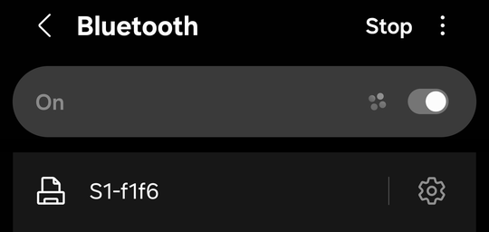

3. Open Mo Mobile from your app drawer and choose Everything on this phone. When Android asks about nearby devices, tap Allow; that's how the app talks to the printer.

   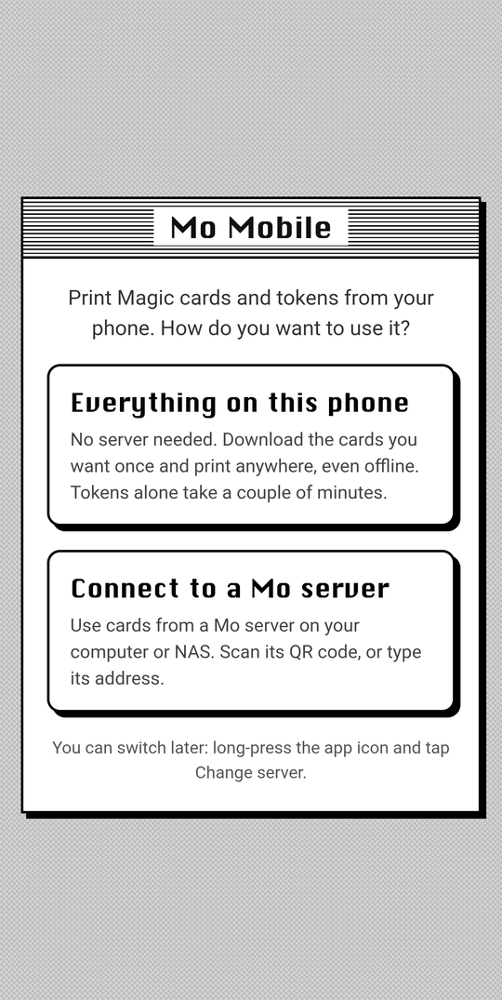
4. Pick which cards to download and tap Download. Do it on Wi-Fi: tokens take a couple of minutes, everything about half an hour. Keep the app open while it works.

   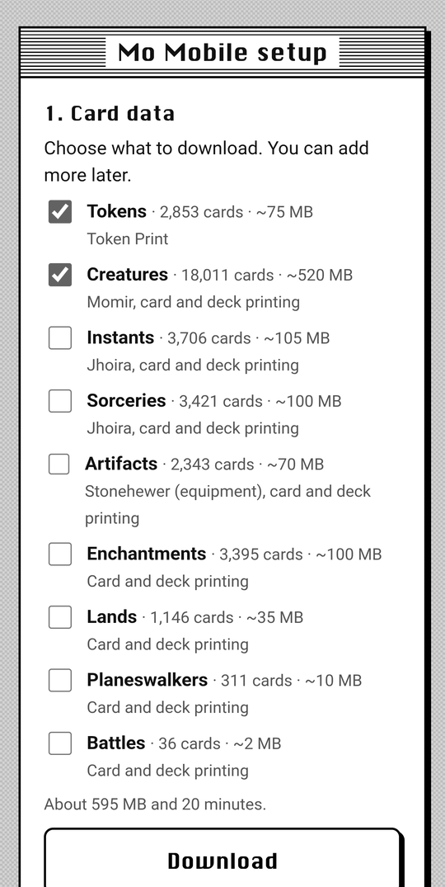

5. When it's done, Mo opens by itself. Print something (see [Print something](#5-print-something) below).

To download more kinds of cards later, long-press the app icon and tap Manage cards.

---

# Your phone plus a computer

## 1. Install Docker

Docker runs the server for you. This is the only thing you install on the computer.

<details>
<summary>Windows or Mac</summary>

Get Docker Desktop from https://www.docker.com/products/docker-desktop/ and install it (on a Mac, pick Apple Silicon or Intel to match yours). Restart if it asks, then open Docker Desktop once and wait until it says it's running.

In Docker Desktop's settings, turn on "Start Docker Desktop when you sign in", so the server comes back after a restart.
</details>

<details>
<summary>Linux</summary>

```
curl -fsSL https://get.docker.com | sh
sudo usermod -aG docker $USER
```

Then log out and back in so `docker` works without `sudo`.
</details>

## 2. Start the server

<details>
<summary>Windows</summary>

Download `MoMobile-setup.bat` from the [latest release](https://github.com/mo-mobile/mo-mobile/releases/latest) and double-click it. If Windows warns about it, click "More info" and then "Run anyway". (It's three lines; open it in Notepad if you want to see what it does. It runs [setup.ps1](../setup/setup.ps1).)

Windows asks once for permission to let your phone reach the server. Click Yes.
</details>

<details>
<summary>Mac or Linux</summary>

Open Terminal and paste:

```
curl -fsSL https://raw.githubusercontent.com/mo-mobile/mo-mobile/main/setup/setup.sh | sh
```

You can read [setup.sh](../setup/setup.sh) first if you like.
</details>

The setup downloads the server, starts it, and opens the setup page in your browser. Running it again later updates the server and keeps your card data.

## 3. The setup page

The setup page asks which cards to download (tokens are a couple of minutes; everything is about half an hour and 1 GB), then shows the progress and a QR code for your phone. You don't have to wait for the download; carry on with your phone.

 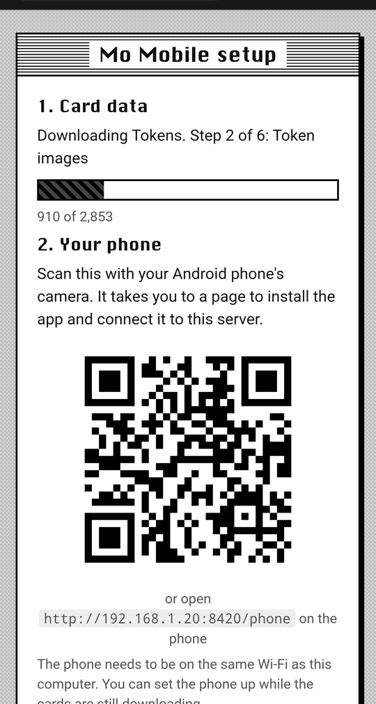

You can add more kinds of cards on the same page later: it's at `http://<your computer's address>:8420/setup`, or long-press the app icon and tap Manage cards.

## 4. Set up your phone

Scan the QR code with your phone's camera. It opens a page with everything the phone needs:

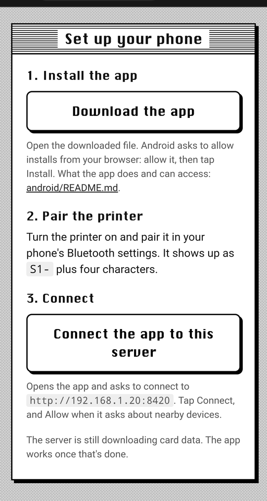

1. Download the app. Open the downloaded file. Android asks to allow installs from your browser; allow it and tap Install. If you want to know exactly what the app does and can access first, it's all in [android/README.md](../android/README.md).
2. Pair the printer. Turn it on and pair it in your phone's Bluetooth settings (Settings → Connections → Bluetooth on Samsung). It shows up as `S1-` plus four characters.

   

3. Connect. Back on that page, tap "Connect the app to this server". The app opens and asks whether to connect; tap Connect. (On a brand-new install, the app first shows its welcome screen; the Connect link still works.) When Android asks about nearby devices, tap Allow, since that's how the app talks to the printer.

   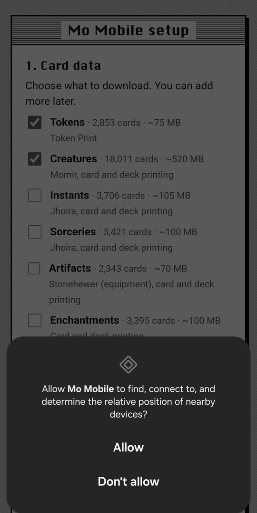

Until the cards finish downloading, the app shows the progress. Once they're done it switches to Mo by itself.

---

## 5. Print something

Scroll down to Token Print, type `gob`, pick a Goblin and hit Print. The first print takes a second to connect.

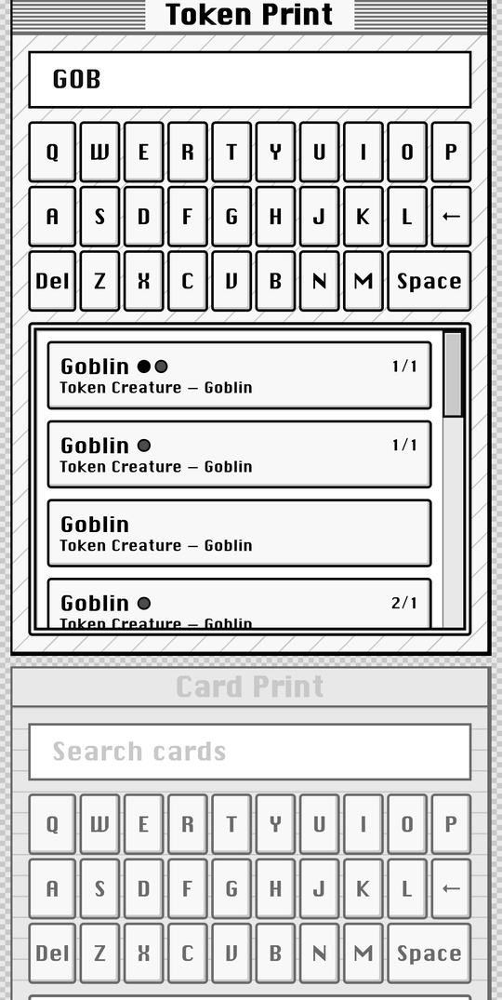 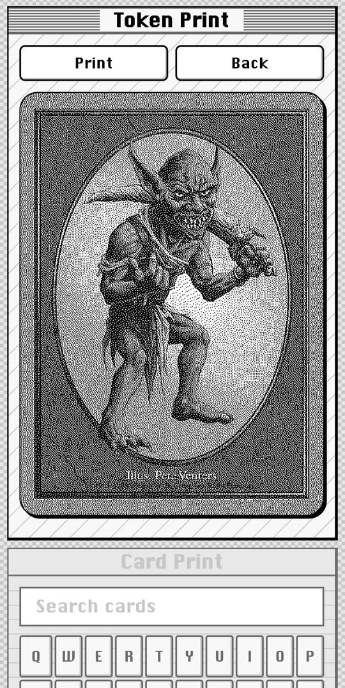

For Momir, tap a number and hit Print Creature.

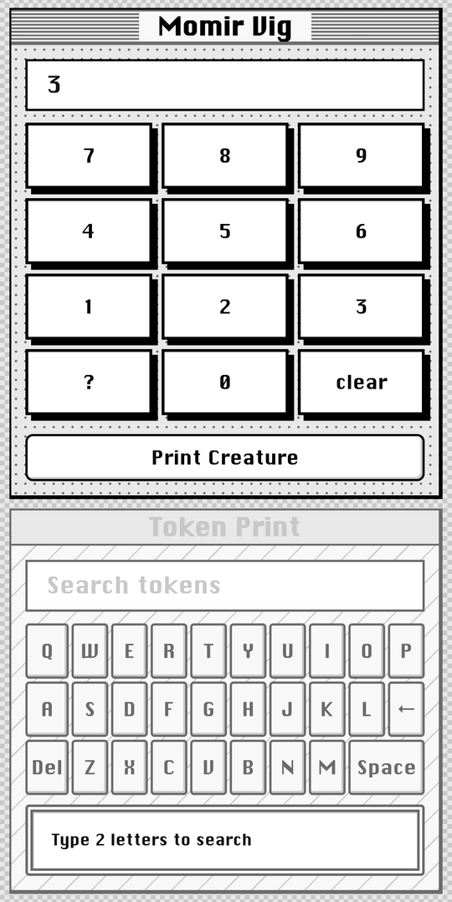

That's it.

---

## Tips

Out of the box, the S1 turns itself off after 15 minutes idle. You can stretch that to 4 hours with the printer maker's app, HerePrint (Play Store): connect to the printer, open Settings → Standby time, and pick 240 minutes. Mine ignored the first tap, so if it doesn't stick, pick a different value and then 240 again. The setting lives in the printer, so close HerePrint afterwards. Only one app can be connected to the printer at a time.

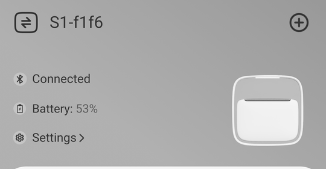 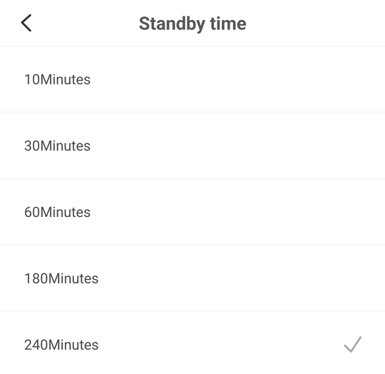

If the printer's off when you hit Print, the page tells you to turn it on and try again.

To point the app at a different server, or switch between a server and the phone-only way, long-press the app icon and tap Change server. You can also scan a server's QR code and tap Connect.

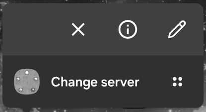

Away from home, your phone can't see a server on your home network. I use [Tailscale](https://tailscale.com) for that: install it on the computer and the phone, then use the computer's Tailscale address (`100.x.x.x:8420`) as the server.

The setup page is always at `http://<your computer's address>:8420/setup` if you need the QR code again.

## Troubleshooting

### My phone can't open the QR code page

Check that the phone is on the same Wi-Fi as the computer and not on mobile data. If it is, the computer's firewall is probably blocking it.

- Windows: run the setup again and click Yes when it asks about the firewall. Or, in PowerShell run as administrator:
  ```
  New-NetFirewallRule -DisplayName "MoMobile" -Direction Inbound -Protocol TCP -LocalPort 8420 -Action Allow -Profile Private
  ```
  If your Wi-Fi is set to a Public network in Windows, switch it to Private.
- Mac: if the firewall is on (System Settings → Network → Firewall), allow incoming connections for Docker.
- Linux: if `sudo ufw status` says active, run `sudo ufw allow 8420/tcp`.

### The setup says Docker isn't installed or isn't running

On Windows and Mac, open Docker Desktop and wait until it says it's running, then run the setup again. On Linux, make sure you logged out and back in after installing, and check `sudo systemctl status docker`.

### The card download stopped with an error

The setup page offers to start it again, and it keeps what was already downloaded. Restarting the server (or the app, on the phone-only way) also picks up where it left off.

### The app says "Pick your printer"

It found more than one possible printer, or none it recognized. Pick the `S1-` one from the list. It remembers your choice.

### Prints cut off, or nothing prints

Make sure nothing else is connected to the printer (HerePrint, a PC) and that it's charged.

### Updating

Run the setup again. It downloads the newest server and keeps your card data.

---

## The manual way

If you'd rather build the server from source than use the published image, you need Git and Docker:

```
git clone https://github.com/mo-mobile/mo-mobile.git
cd mo-mobile
docker compose up -d --build
```

Then open http://localhost:8420/setup. To update: `git pull` and the same `docker compose` command. Running without Docker, or on a NAS with your own folders, is covered in [PHONE_PRINTING.md](PHONE_PRINTING.md).
