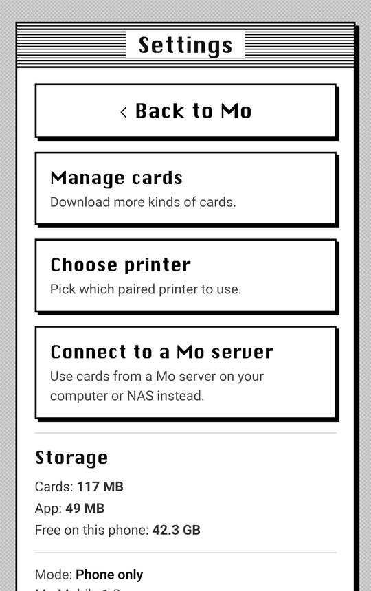

# Quick Start Guide

You can run this two ways:

- Just your phone. The app downloads the cards and runs everything itself. You don't need a computer, and it works anywhere, even with no signal. Tokens are ready in about two minutes.
- Your phone plus a computer. The computer keeps the cards and your phone prints from it. This is nice if a few people want to print from the same setup, or if you don't want the cards taking up space on your phone.

If you want to know how it all works, or need more help, see [PHONE_PRINTING.md](PHONE_PRINTING.md).

## What you need

- An iDPRT/HPRT S1 printer (48 mm paper). That's the one I have. Other printers use different commands, so they'd need their own driver in `app/printer.py`.
- An Android phone running Android 8 or newer. It has to be 64-bit, which is pretty much any phone from the last several years. iPhones won't work because iOS doesn't allow the kind of Bluetooth connection the printer needs.
- For the phone plus computer way, a Windows, Mac or Linux computer that stays on while you play and is on the same Wi-Fi as your phone.

Everything together is about 1 GB, but you pick what to download. Tokens by themselves are about 75 MB.

I run the server in Docker on my Synology NAS and print from a Samsung phone. I don't have a Mac, so I haven't tested the Mac steps. If something doesn't work, open an issue.

---

# Just your phone

1. On your phone, download `MoMobile.apk` from the [latest release](https://github.com/mo-mobile/mo-mobile/releases/latest) and open it. Android will ask if your browser is allowed to install apps. Allow it, then tap Install. If you want to see what the app does and can access first, it's all in [android/README.md](../android/README.md).
2. Turn the printer on and pair it in your phone's Bluetooth settings (on Samsung it's Settings → Connections → Bluetooth). It shows up as `S1-` and four characters.

   

3. Open Mo Mobile and pick Everything on this phone. When Android asks about nearby devices, tap Allow. The app needs that to talk to the printer.

   
4. Pick the cards you want and tap Download. Use Wi-Fi for this. Tokens take a couple minutes and everything takes about half an hour. If you want to use other apps while it downloads, tick "Keep downloading when I leave the app" first. You can pause it and pick it back up later. If your phone has an SD card, the app will ask where you want the cards.

   

5. Mo opens by itself when it's done. Go [print something](#5-print-something).

The gear in the Momir Vig title bar opens settings. From there you can download more cards or delete some, pick your printer, switch to a server, and see how much space everything takes. Swipe the Momir window to get to Stonehewer and Jhoira, and swipe Deck Print to get to Top 8. The dots show which one you're on.

   

---

# Your phone plus a computer

## 1. Install Docker

Docker is what runs the server. It's the only thing you need to install on the computer.

<details>
<summary>Windows or Mac</summary>

Get Docker Desktop from https://www.docker.com/products/docker-desktop/ and install it. On a Mac, pick Apple Silicon or Intel depending on your Mac. Restart if it asks you to, then open Docker Desktop and wait for it to say it's running.

In Docker Desktop's settings, turn on "Start Docker Desktop when you sign in" so the server starts back up after a restart.
</details>

<details>
<summary>Linux</summary>

```
curl -fsSL https://get.docker.com | sh
sudo usermod -aG docker $USER
```

Then log out and back in so you can use `docker` without `sudo`.
</details>

## 2. Start the server

<details>
<summary>Windows</summary>

Download `MoMobile-setup.bat` from the [latest release](https://github.com/mo-mobile/mo-mobile/releases/latest) and double-click it. If Windows warns you about it, click "More info" and then "Run anyway". The file is only three lines and just runs [setup.ps1](../setup/setup.ps1), so open it in Notepad if you want to check.

Windows will ask once if your phone is allowed to reach the server. Click Yes.
</details>

<details>
<summary>Mac or Linux</summary>

Open Terminal and paste this:

```
curl -fsSL https://raw.githubusercontent.com/mo-mobile/mo-mobile/main/setup/setup.sh | sh
```

You can read [setup.sh](../setup/setup.sh) first if you want.
</details>

The setup downloads the server, starts it, and opens the setup page in your browser. If you run it again later it updates the server and keeps your cards.

## 3. The setup page

Pick which cards to download. Tokens take a couple minutes and everything takes about half an hour and 1 GB. After that it shows the progress and a QR code for your phone. You don't have to wait for it to finish before setting up your phone.

 

You can come back and add more cards later. The page is at `http://<your computer's address>:8420/setup`, or tap the gear in the app and then Manage cards.

## 4. Set up your phone

Scan the QR code with your phone's camera. It opens a page with everything you need for the phone:


1. Download the app and open the file. Android will ask if your browser is allowed to install apps. Allow it, then tap Install. If you want to see what the app does and can access first, it's all in [android/README.md](../android/README.md).
2. Turn the printer on and pair it in your phone's Bluetooth settings (on Samsung it's Settings → Connections → Bluetooth). It shows up as `S1-` and four characters.

   

3. Go back to that page and tap "Connect the app to this server". The app opens and asks if you want to connect. Tap Connect. If it's a fresh install you'll see the welcome screen first, but the link still works. When Android asks about nearby devices, tap Allow. The app needs that to talk to the printer.

   

The app shows the download progress until the cards are ready, then switches to Mo by itself.

---

## 5. Print something

Scroll down to Token Print, type `gob`, pick a Goblin and hit Print. The first print takes a second to connect.

 

For Momir, tap a number and hit Print Creature.


---

## Tips

The S1 turns itself off after 15 minutes by default. You can make that 4 hours with the printer's own app, HerePrint (it's on the Play Store). Connect to the printer, go to Settings → Standby time and pick 240 minutes. Mine didn't take the first time, so if it doesn't stick, pick something else and then 240 again. The printer remembers it, so you can close HerePrint after. Only one app can be connected to the printer at a time.

 

If the printer is off when you hit Print, Mo will tell you to turn it on and try again.

To switch servers, or go between a server and just your phone, tap the gear in the Momir Vig title bar. Scanning a server's QR code and tapping Connect works too.

Your phone can't reach a server on your home network when you're out. I use [Tailscale](https://tailscale.com) for that. Put it on the computer and your phone, then use the computer's Tailscale address (`100.x.x.x:8420`) as the server.

If you need the QR code again, the setup page is always at `http://<your computer's address>:8420/setup`.

## Troubleshooting

### My phone can't open the QR code page

Make sure your phone is on the same Wi-Fi as the computer and not on mobile data. If it is, the computer's firewall is probably blocking it.

- Windows: run the setup again and click Yes when it asks about the firewall. You can also open PowerShell as administrator and run:
  ```
  New-NetFirewallRule -DisplayName "MoMobile" -Direction Inbound -Protocol TCP -LocalPort 8420 -Action Allow -Profile Private
  ```
  If Windows has your Wi-Fi set as a Public network, change it to Private.
- Mac: if the firewall is on (System Settings → Network → Firewall), allow incoming connections for Docker.
- Linux: if `sudo ufw status` says active, run `sudo ufw allow 8420/tcp`.

### The setup says Docker isn't installed or isn't running

On Windows and Mac, open Docker Desktop, wait for it to say it's running, and run the setup again. On Linux, make sure you logged out and back in after installing, and check `sudo systemctl status docker`.

### The card download stopped with an error

The setup page will offer to start it again, and it keeps whatever already downloaded. Restarting the server (or the app, if you're running just your phone) also picks it back up.

### The app says "Pick your printer"

It either found more than one printer or none it recognized. Pick the `S1-` one. It'll remember it.

### Prints get cut off, or nothing prints

Make sure nothing else is connected to the printer, like HerePrint or a computer, and that it's charged.

### Updating

Run the setup again. It grabs the newest server and keeps your cards.

---

## Doing it by hand

If you'd rather build the server yourself instead of using mine, you need Git and Docker:

```
git clone https://github.com/mo-mobile/mo-mobile.git
cd mo-mobile
docker compose up -d --build
```

Then go to http://localhost:8420/setup. To update, run `git pull` and the same `docker compose` command. Running it without Docker, or on a NAS with your own folders, is in [PHONE_PRINTING.md](PHONE_PRINTING.md).
